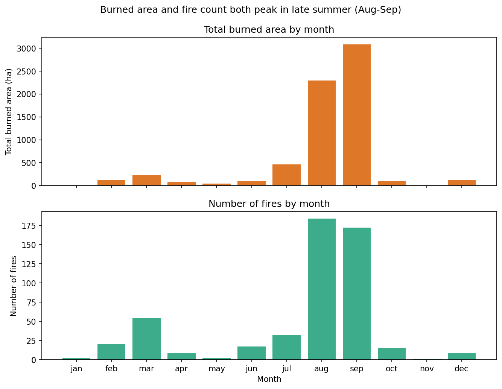
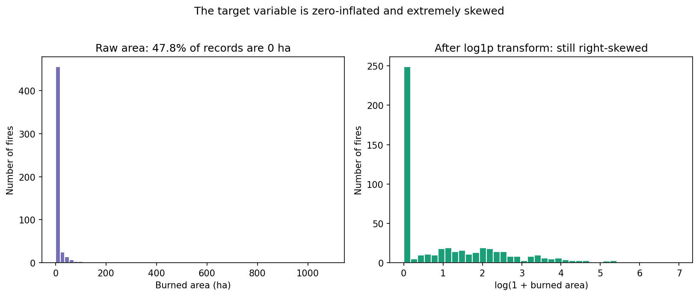
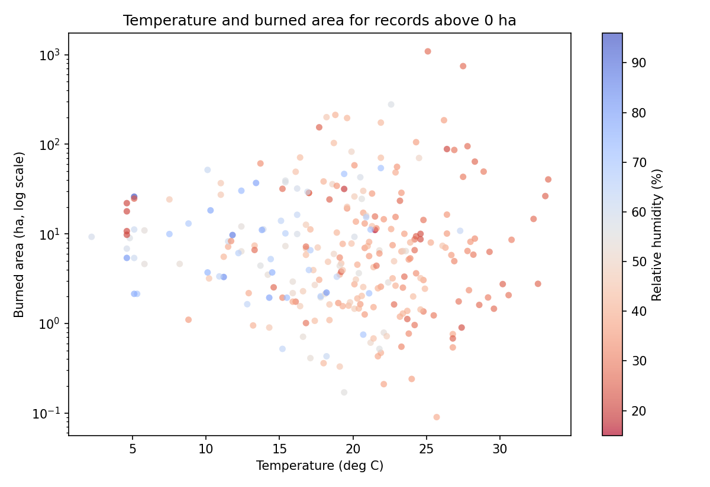
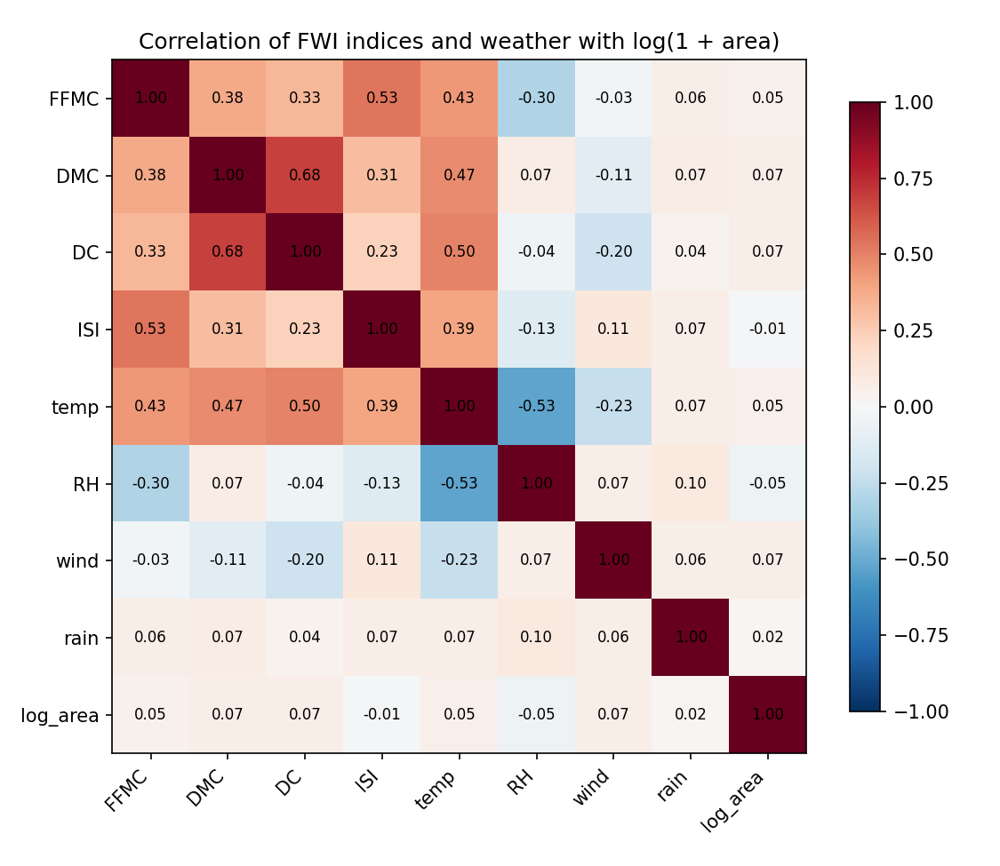
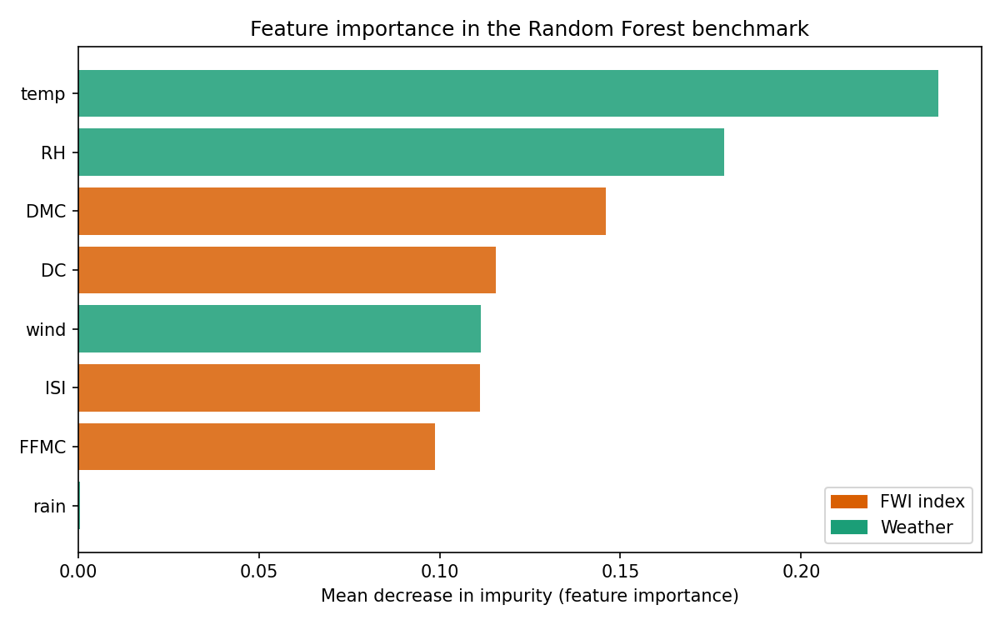
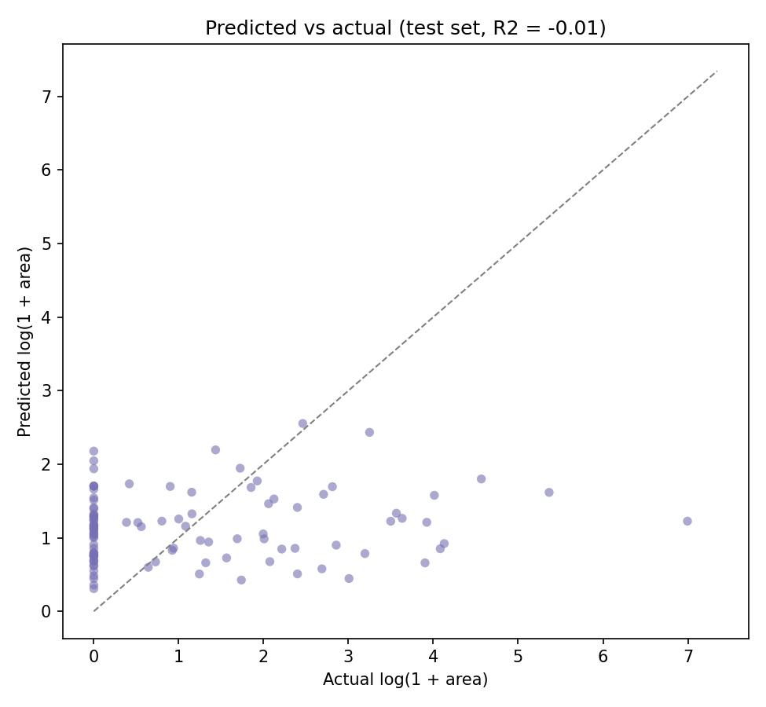

# Forest Fire Burned-Area Analysis (Montesinho Natural Park)


-green)


> **Can weather and fire-danger indices explain how much a forest fire burns?
> Spoiler: only up to a point - and the failure itself is the finding.**

End-to-end data science project on 517 forest fires in Portugal's Montesinho
Natural Park: exploratory analysis, publication-quality visualizations, and a
Random Forest benchmark. Built as a portfolio project for CISC7204 Data
Visualization (University of Macau).

## Table of Contents

- [Research Question](#research-question)
- [Dataset](#dataset)
- [Project Structure](#project-structure)
- [Key Findings](#key-findings)
- [Model Benchmark](#model-benchmark)
- [Limitations](#limitations)
- [Future Work](#future-work)
- [How to Run](#how-to-run)
- [References](#references)

## Research Question

When and under what weather conditions do the most damaging forest fires occur
in Montesinho Natural Park, and how well do the Fire Weather Index (FWI)
components (FFMC, DMC, DC, ISI) predict the burned area?

## Dataset

| | |
|---|---|
| **Source** | [UCI Machine Learning Repository - Forest Fires](https://archive.ics.uci.edu/dataset/162/forest+fires) (Cortez & Morais, 2007) |
| **License** | Creative Commons Attribution 4.0 International (CC BY 4.0) - free to share and adapt with attribution |
| **Size** | 517 fires, 13 attributes, Montesinho Natural Park, Portugal, 2000-2003 |
| **Features** | FWI indices (FFMC, DMC, DC, ISI), weather (`temp`, `RH`, `wind`, `rain`), calendar (`month`, `day`), park grid coordinates (`X`, `Y`) |
| **Target** | `area` - burned area in hectares |
| **File** | `forestfires.csv` (included in this repository) |

## Project Structure

```
data-science-project/
|-- analysis.py              # full pipeline: EDA figures + model benchmark
|-- forestfires.csv          # dataset (UCI, CC BY 4.0)
|-- requirements.txt         # Python dependencies
|-- figures/                 # all generated visualizations
|   |-- monthly_burned_area.png
|   |-- area_distribution.png
|   |-- temp_vs_area.png
|   |-- correlation_heatmap.png
|   |-- feature_importance.png
|   |-- predicted_vs_actual.png
|-- README.md
```

## Key Findings

### 1. Fire damage is concentrated in late summer

August and September account for 5,384 ha of the 6,642 ha total burned area
(81.1%). These months also had the highest fire counts in the sample.



### 2. The target is zero-inflated and extremely skewed

Burned area was recorded as 0 ha for 47.8% of fires and below 1 ha for 53.0%.
The largest recorded fire burned 1,090.8 ha. The mean is 12.8 ha and the
median is 0.5 ha. Even after a
`log1p` transform the distribution stays right-skewed - a warning sign for any
regression model.



### 3. Low humidity was common among the largest fires

Of the 11 fires that burned more than 100 ha, nine occurred below 45% relative
humidity and five occurred both below 45% humidity and above 20 °C. The plot
shows records with positive burned area because the vertical axis is logarithmic.



### 4. But no single variable explains fire size

Pearson correlations between each weather or FWI variable and `log1p(area)`
are weak (|r| < 0.1). This measures linear association in the sample.



## Model Benchmark

A Random Forest regressor (`n_estimators=400`, `min_samples_leaf=3`) predicts
`log1p(area)` from the 4 FWI indices and 4 weather variables, evaluated on a
held-out 20% test split (`random_state=42`):

| Model | MAE (log-ha) | R2 |
|---|---|---|
| Baseline (predict train median) | 1.133 | -0.229 |
| Random Forest | 1.193 | -0.011 |





The Random Forest had higher mean absolute error than the median baseline on
the log scale. Its R² improved over that baseline and remained slightly below
zero. This split provides limited evidence of predictive value from the eight
inputs. Terrain, fuel load, and firefighting response time are examples of
variables that could be tested with additional data.

## Limitations

- **Weak predictive signal:** weather and FWI features alone are insufficient;
  the best model achieves R2 ~= 0 on held-out data.
- **Many zeros:** 47.8% of records have `area = 0`. A two-part model could
  estimate the chance of positive burned area and then estimate its size.
- **Small, old, single-park dataset:** 517 records from one park (2000-2003)
  limit generalization to other regions or today's climate.

## Future Work

- Compare a two-part model with the baselines using repeated splits. First
  predict whether the recorded burned area is positive, then estimate its size.
- Try gradient boosting (XGBoost/LightGBM) with spatial features (`X`, `Y`
  grid coordinates) and month as a categorical feature.
- Add external data sources (firefighting response times, land cover) to test
  whether the missing signal is recoverable.

## How to Run

```bash
git clone https://github.com/aungminnkhant94/data-science-project.git
cd data-science-project
python -m pip install -r requirements.txt
python analysis.py
```

The script uses the UCI dataset included as `forestfires.csv`, prints summary
statistics and model metrics, and regenerates all six figures in `figures/`.

## References

- Cortez, P. & Morais, A. (2007). *A Data Mining Approach to Predict Forest
  Fires using Meteorological Data.* Proceedings of EPIA 2007.
- UCI Machine Learning Repository: Forest Fires dataset,
  https://archive.ics.uci.edu/dataset/162/forest+fires
